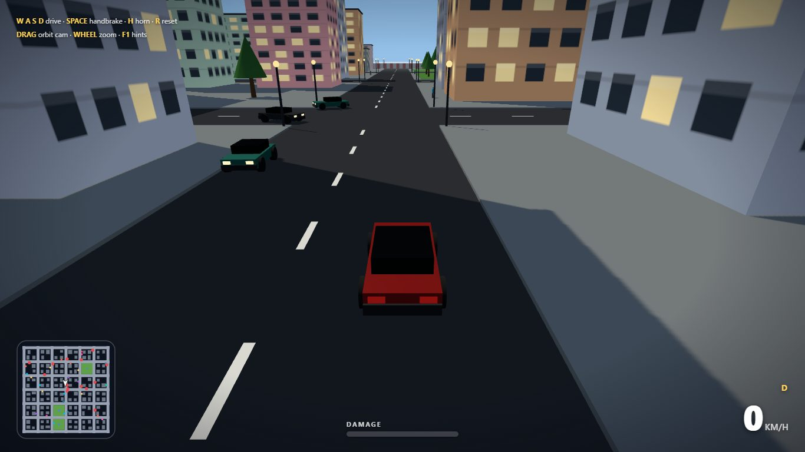
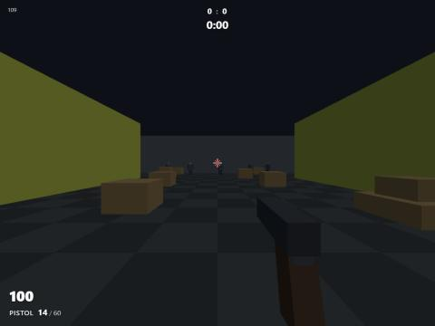
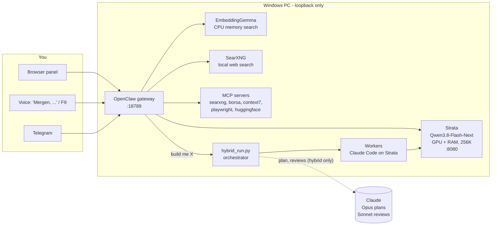
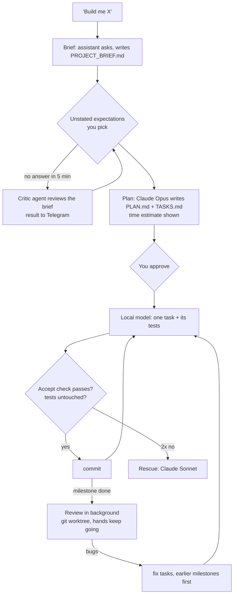

<div align="center">

# 🏹 MERGEN

**A local-first AI assistant and a hybrid Claude + local-model software pipeline, on one Windows PC.**

*Named after Mergen, the Turkic god of wisdom and reason - the archer whose arrow never misses.*


</div>

> **🇹🇷 Türkçe özet:** MERGEN, tek bir bilgisayarda tamamen yerel çalışan, Türkçe (ya da kurulumda seçtiğiniz dilde)
> konuşan bir yapay zekâ asistanı ve yazılım geliştirme hattıdır. Qwen3.8-Flash-Next modeli
> [Strata](https://github.com/Niko1221/Strata) ile ekran kartı + sistem RAM'i üzerinde 256K bağlamla çalışır;
> [OpenClaw](https://docs.openclaw.ai) ajanı yürütür. Sesli komut ("Mergen, ..."), Telegram, web araması (yerel
> SearXNG), dosya ve uygulama yönetimi, araştırma ve YouTube analizi yapabilir. "Bana X yap" dediğinizde hibrit hat
> devreye girer: Claude planlar ve inceler, yerel model kodu yazar ve test eder, deterministik bir Python orkestratörü
> döngüyü yönetir. "Tam local" derseniz planlama ve inceleme de yerel modelde yapılır, hiçbir şey buluta gitmez. Silme
> ve taşıma her zaman onay ister; kişisel veri buluta gönderilmez. Kurulumu yapay zekâ asistanınıza da yaptırabilirsiniz
> ([aşağıda](#let-your-ai-set-it-up)). Gerçek sonuçlar, başarısızlıklar dahil: [docs/hybrid-results.md](docs/hybrid-results.md).

<p align="center">
  
  
</p>
<p align="center"><sub>Built by the pipeline: <a href="examples/town-driving-game">a 3D driving game</a> (86 tasks, 570 tests) and <a href="examples/strike-arena">strike-arena</a>, a browser FPS (39 tasks, 535 tests).</sub></p>

---

## What it is

- **An assistant that lives on your PC.** MERGEN speaks Turkish - or the language you pick at setup - has opinions
  and pushes back. It handles files, apps, music, web research and YouTube analysis, and asks before anything it
  cannot undo. Reach it from the browser, by voice ("Mergen, ...") or from your phone over Telegram.
- **A software pipeline that is honest about itself.** Ask for a program and a deterministic orchestrator runs it:
  Claude plans and reviews, the local model writes every task and its tests, nothing is committed unless its test
  passes. See [what really happened](docs/hybrid-results.md) on six builds.
- **Hybrid or fully local - your call.** Say *"tam local"* (fully local) and the local model also plans, reviews and
  rescues: no Claude account, no cloud calls, nothing leaves the PC
  ([modes](docs/hybrid-dev.md#brain-mode-cloud-or-fully-local)).
- **One GPU, three modes.** A 93 GB model runs on a 32 GB card by keeping the hot experts in VRAM and the rest in
  system RAM. Switch the card between the agent, a creative 27B model + ComfyUI, or nothing (gaming) in one click.

## What you need

| | |
|---|---|
| **Graphics card** | NVIDIA with **12 GB+ VRAM** and driver 580+ (other cards: [Strata's list](https://github.com/Niko1221/Strata#what-you-need)). Tested on an RTX 5090 32 GB. |
| **RAM** | **32 GB+**. It decides the model build: 32 GB -> `CODER`, 48-64 GB -> `IQ2_XS`, 96 GB+ -> `UD-IQ4_XS` ([all builds](#model-builds)). |
| **Disk** | ~80-120 GB free for the model, ideally NVMe. |
| **System** | Windows 11 (10 should work, untested), a **fixed page file** of ~64 GB ([why](docs/known-issues.md)), Node.js 24.16+, git. Docker Desktop for local web search (optional). |
| **Optional** | a Claude account for the hybrid pipeline (fully local mode needs none), a Telegram bot, a microphone. |

## Install

### Let your AI set it up

Using an AI coding assistant (Claude Code, Cursor, Codex, GitHub Copilot, ...)? Paste this into it:

```text
Set up MERGEN on this PC for me: https://github.com/mahmuterenakkaymak/mergen - follow docs/AI_SETUP.md in that repository.
```

It checks your GPU, RAM, disk and page file, picks the model build that fits, installs Strata and OpenClaw, verifies
them, and asks you before anything it should not decide alone (system settings, the download size, your tokens).

### Or do it yourself

PowerShell, in order. Every script has its settings at the top and arrow-key menus where you have a choice.

```powershell
# 0. once: a fixed 64 GB page file on C:, then reboot (docs/known-issues.md)

# 1. Strata + a Qwen3.8-Flash-Next build: arrow keys + Enter (the build for your RAM is preselected),
#    then it shows the download size and free disk space and asks before downloading
.\scripts\01-install-strata.ps1                  # or no menu: -Model IQ3_S / UD-IQ4_XS / IQ2_XS / CODER ...

# 2. start Strata (the PC can stutter for 1-3 minutes while the model loads), then OpenClaw (pinned) + its gateway
.\scripts\start-all.bat
.\scripts\02-install-openclaw.ps1

# 3. point OpenClaw at Strata; web search, memory, skills, MERGEN's identity files.
#    Menus: MERGEN's language, then the voice language (Turkish or English)
.\scripts\03-configure-openclaw.ps1             # or no menus: -Language German -Voice en

# 4. check everything end to end
.\scripts\verify.ps1
```

Step 3 ends with one interactive step OpenClaw has no flag for (the local embedding server); the script prints exactly
what to pick. From then on, start everything with **`MERGEN-START.bat`**. Switching models later: run step 1 with
another `-Model`, then step 3. Optional: voice ([voice/](voice/)), a Telegram bot ([MCP & channels](docs/mcp.md)),
`HYBRID_NOTIFY_TELEGRAM=<your chat id>` for pipeline notifications and research reports, `TAVILY_API_KEY` (free tier)
for reliable web search in deep research, `UNSLOTH_API_KEY` for creative mode
([modes](docs/modes-and-models.md)).

### Model builds

| Build | Needs (RAM + VRAM) | Download | Character |
|---|---:|---:|---|
| `Q2_0` | 38 GB | up to ~70 GB | fastest |
| `IQ2_XS` | 40 GB | up to ~70 GB | fast, better - Strata's pick for 48-64 GB |
| `IQ3_XXS` / `IQ3_S` | 47 / 55 GB | up to ~70 GB | slower, best of Strata's own builds |
| `UD-IQ4_XS` | ~80 GB + SSD | 94 GB | ~4-bit Unsloth build, **this repo's tested setup** |
| `UD-Q4_K_XL` | 64 GB + NVMe | 111 GB | experimental, experts streamed from the SSD |
| `SWIFT-*` | 38-47 GB | up to ~70 GB | Swift 1.5 fine-tune, thinks shorter |
| `CODER` | 32 GB | up to ~70 GB | best at code, weaker elsewhere |

## Architecture



Everything binds to `127.0.0.1`. The only cloud calls are the hybrid pipeline's planning and reviews (and they fall back
to the local model when the Claude limit is reached); in fully local mode there are none. Web search sends only the
query, through your own SearXNG.

## The hybrid pipeline



The loop is plain Python, not an LLM: task order, running tests, retries, the cloud budget and test-tampering checks
are code. The local model can't weaken a test to pass (Python tests are compared by AST, others line by line), cloud
reviews run in parallel with the build, and every milestone, rescue, failure and finish is pushed to Telegram.
Workers follow a short change discipline (smallest complete change, touch only what the task needs, reuse before
writing, test-first for fixes) and, since nobody can answer questions at 3 a.m., leave `ASSUMPTION:` notes that the
review checks. Python, JavaScript/TypeScript and .NET projects are supported.

What it checks besides each task's own tests: after every milestone **all** test suites and smoke runs of the real
program run (a later fix cannot silently break an older test), the app is started and its user flows are clicked and
played in a headless browser for a **visual review** by the local model, and workers open the pages they build
themselves. For games and UIs, `--prototype` first lets the local model build a free, rich sketch that the plan must
match.

**Two modes, one pipeline.** *Hybrid* (default): Claude is the brain, the local model the hands. *Fully local*
(`--brain local`, or just say *"tam local"*): Strata is both, for private data or when you have no Claude account.
All results below are hybrid runs; a fully local build has not been measured yet.

**Results so far** ([details](docs/hybrid-results.md)):

| Run | Tasks | First try | Tests | Time | Bugs the reviews found |
|---|---:|---:|---:|---:|---:|
| Receipt parser (Python) | 16 | 12/12 tried | 106 | 12 min for 8 tasks | 3 |
| Driving game v1 | 19 | 19/19 | 195 | 35 min | 3 |
| *Same game, written in one go without the pipeline* | - | - | 0 | ~2 min | - |
| Driving game v2 (full scope) | 51 | 47/48 | 751 | 178 min | 6 |
| [strike-arena FPS](examples/strike-arena) | 39 | **39/39** | 535 | 124 min | 10 |
| [Driving game v3](examples/town-driving-game) (`--prototype`) | 86 | 78/86 | 570 | ~4 h 15 min | 16 + 21 visual |

And the lessons that matter most: 535 green tests did not notice that strike-arena's menu never closed, and 570 did
not notice traffic cars without bodies - one renderer read fields another module never set. Tests are not eyes, and
green task tests are not a working whole: that is what the visual review and the whole-project checks are for. v3's
8 first-try misses were the pipeline's own bug (a reviewer appended an explanation to accept commands), now caught.

## Speed

Measured on the tested setup below with `scripts/bench_strata.py` (median of 3, [details](docs/benchmarks.md)):

| | Tokens/s |
|---|---:|
| Output, short prompt | **~119** |
| Prompt reading, 49K-token prompt | **~3,650** |
| Output after a 49K-token prompt | **~72** |
| Hybrid worker, real tasks | ~90 (75-117) |

| Strata RAM budget | Strata working set | Free RAM | Speed change |
|---|---:|---:|---:|
| 55 GiB experts, 8 GB cache | ~70 GB | 1.8 GB | - |
| **40 GiB experts, 4 GB cache** (default) | **46 GB** | **~27 GB** | -2 to -9% |

**Tested setup**

| Part | Version / value |
|---|---|
| OS | Windows 11 Pro 26200 (+ WSL2 Ubuntu 24.04 for creative mode) |
| Hardware | RTX 5090 32 GB · 96 GB DDR5-6400 · Ryzen 9 9950X3D |
| Page file | **fixed 64 GB** on C: ([why](docs/known-issues.md)) |
| Strata | engine 0.1.43.1, Qwen3.8-Flash-Next **any build** (tested: Unsloth UD-IQ4_XS), 256K context, 8-bit KV |
| OpenClaw | **2026.8.35** (pinned; newer releases hit a state-database lock on Windows - [known issues](docs/known-issues.md)) |
| Node.js | 24.21 |
| Voice | faster-whisper (large-v3-turbo + small), Piper `tr_TR-dfki`, all on CPU |

## Daily use

| | |
|---|---|
| **MERGEN** (`MERGEN-START.bat`) | agent mode on, gateway checked, dashboard + mode panel + voice widget open |
| **AI Modes** (`scripts\mode-panel.bat`) | live VRAM / service status, one-click switch: **Agent** (Strata) · **Creative** (Unsloth Studio Qwen3.8-27B + ComfyUI) · **GPU free**; code pipeline switch **Full local** · **Hybrid (Claude + Mergen)**; **New chat** button; TR / EN |
| **MERGEN Voice** (`voice\mergen-voice.bat`) | always-on-top widget; click or **Ctrl+Alt+M** to listen |
| Panel | http://127.0.0.1:18789 - `/new` for a fresh session, `/reasoning on` to see the model think |
| Telegram | the same assistant on your phone; voice notes are transcribed locally |
| `claude-local` | Claude Code on the local model - no limits, nothing leaves the PC |

**Building software:** just ask in the panel - *"Build me a browser FPS"* / *"Tarayıcıda oynanan bir FPS yap"*. Say
*"tam local"* (fully local) to keep even planning and reviews on your own GPU.

## Voice and languages

Say **"Mergen, <command>"** in one sentence, or hold **F9**. A small Whisper model listens for the name,
`large-v3-turbo` confirms it and transcribes; the answer is spoken with a Piper voice. Everything runs on the CPU, no
audio leaves the PC, and speech not addressed to MERGEN is never logged. Setup and tuning: [voice/](voice/).

| | Turkish | English | Other languages |
|---|---|---|---|
| Chat, skills, reports | yes | yes | yes - pick it at setup or type its name; quality depends on the model |
| Voice (wake word, F9, spoken replies) | yes, tested | yes, not yet tested with a real mic | no - use Turkish or English voice, or none |
| Pipeline notifications (Telegram) | yes | yes | in English |
| Piper voice license | `tr_TR-dfki`: **CC BY-NC-SA 4.0**, personal use only | `en_US-ljspeech`: public-domain data | - |

Qwen does not publish a language list for Qwen3.8-Flash-Next, so the setup menu shows 22 common languages and *Other*
takes any name.

## Skills

| Skill | What it does |
|---|---|
| `windows-assistant` | files, apps, Spotify, media keys, "search / open in Google". **Asks before every delete and move.** |
| `project-brief` | turns an idea into a buildable brief; lists what you didn't say but will expect |
| `hybrid-dev` | starts the orchestrator, reports progress, never writes the project itself |
| `deep-research` | 25+ searches, 15+ pages read, every cited page actually fetched and every number found on it - a script checks the report before it counts as done, then sends it to Telegram |
| `youtube-analysis` | video/channel stats and summaries with yt-dlp, numbers computed in Python |

**Recommended extra skills** - not bundled, only pointers. They use the same `SKILL.md` format; copy the ones you want
into `~/.agents/skills` and read them first (third-party skills are untrusted until reviewed).

| Source | License | Skills used with MERGEN |
|---|---|---|
| [addyosmani/agent-skills](https://github.com/addyosmani/agent-skills) | MIT | code-review-and-quality, debugging-and-error-recovery, security-and-hardening |
| [anthropics/skills](https://github.com/anthropics/skills) | per skill (these: Apache 2.0) | frontend-design, mcp-builder |
| [coreyhaines31/marketingskills](https://github.com/coreyhaines31/marketingskills) | MIT | content-strategy, copywriting, launch, pricing, social |

## Safety rules the assistant cannot talk itself out of

1. **Delete** - always asks, shows full paths, uses the Recycle Bin.
2. **Move / rename** - asks, unless your message names both the exact item and the destination.
3. **Data stays home** - no personal, customer or other sensitive data to cloud APIs or search queries.
4. **Secrets** - environment variables only, never printed or committed.
5. **Databases** - read-only connections (the MSSQL MCP stays disabled until a read-only login exists).
6. **Numbers** - totals, taxes, scores are computed in code, never estimated by the model.
7. **Workers are confined** - hybrid workers can only edit their project folder and run an allowlist of commands.

These came from real incidents - see [known issues](docs/known-issues.md) for the day a test moved an entire
Documents folder.

## Repository

| Path | |
|---|---|
| [`hybrid/hybrid_run.py`](hybrid/hybrid_run.py) | the orchestrator: plan, build, background reviews, rescues, limits, Telegram |
| [`scripts/`](scripts/) | install, model selection, GPU modes, start, verify, benchmark |
| [`skills/`](skills/) | the OpenClaw skills (templates, rendered at install) |
| [`openclaw-workspace/`](openclaw-workspace/) | MERGEN's identity: `IDENTITY.md`, `SOUL.md`, `AGENTS.md` |
| [`voice/`](voice/) | wake word, push-to-talk, widget, Telegram voice-note transcriber, Turkish/English strings |
| [`config/`](config/) | OpenClaw settings template (no secrets) |
| [`examples/strike-arena/`](examples/strike-arena/) | a complete project built by the pipeline, with its reviews and log |
| [`docs/`](docs/) | [AI setup](docs/AI_SETUP.md) · [results](docs/hybrid-results.md) · [decisions](docs/decisions.md) · [known issues](docs/known-issues.md) · [benchmarks](docs/benchmarks.md) · [modes & models](docs/modes-and-models.md) · [hybrid dev](docs/hybrid-dev.md) · [MCP](docs/mcp.md) · [roadmap](docs/roadmap.md) |

## Built on

[Strata](https://github.com/Niko1221/Strata) (MIT) · [OpenClaw](https://docs.openclaw.ai) (MIT) ·
[Qwen3.8-Flash-Next](https://huggingface.co/unsloth/Qwen3.8-Flash-Next-GGUF) by the Qwen team, GGUF by Unsloth ·
[Claude Code](https://claude.com/claude-code) · [faster-whisper](https://github.com/SYSTRAN/faster-whisper) (MIT) ·
[Piper](https://github.com/rhasspy/piper) · [SearXNG](https://github.com/searxng/searxng) (AGPL-3.0, run as a separate
container) · [three.js](https://threejs.org) (MIT). None of them is redistributed here; the scripts install them.
See [THIRD_PARTY.md](THIRD_PARTY.md).

## License

[MIT](LICENSE) © 2026 Mahmut Eren Akkaymak
