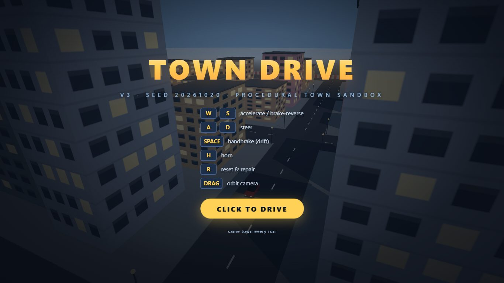

# Town Driving Game

A browser driving game on Three.js and Vite: a seeded procedural town (6x6 blocks), an arcade car with body lean,
skids and damage, traffic and pedestrians, a minimap, a synthesized engine sound and a dusk start screen. No downloaded
assets - the town, the cars, the people and every sound are built in code.

Built by MERGEN's hybrid pipeline on 2026-10-20 (`--prototype` run): Claude Opus planned it, the local model
(Qwen3.8-Flash-Next on Strata) wrote all 86 tasks and their tests, Claude Sonnet and the local model reviewed each
milestone. 570 tests. What went right and wrong: [docs/hybrid-results.md](../../docs/hybrid-results.md) (lessons 7-9).

<p align="center">
  
  
</p>

## Run

```bash
npm install
npm run dev      # vite dev server, http://localhost:5173
npm test         # vitest, whole suite (570 tests)
npm run build    # production bundle in dist/
```

Click the start screen: that click also opens the audio (browsers refuse sound before a user gesture).

## Controls

| Key | Action |
| --- | --- |
| `W` `A` `S` `D` / arrows | Drive: throttle, brake then reverse, steer |
| `Space` | Handbrake (drifts) |
| `H` | Horn |
| `R` | Reset to the spawn |
| Mouse drag / wheel | Orbit / zoom the camera |
| `F1` | Hints |
| `Esc` | Pause |

## What is in this folder

| | |
|---|---|
| `PROJECT_BRIEF.md` | the brief the pipeline started from |
| `prototype/` | the free first version the local model built before the plan (`prototype/FEATURES.md` = the quality bar) |
| `PLAN.md`, `TASKS.md` | the architect's plan and all 86 tasks with their accept commands |
| `REVIEW.md`, `VISUAL_REVIEW.md` | the last code and visual review |
| `hybrid-run/` | the orchestrator log, the run report, every milestone review, and the checks/flows config |
| `src/`, `tests/` | the game and its tests |

Two bugs survived every test and were found by playing it (bumpers and lamps not leaning with the body; traffic cars
without bodies); they were fixed by hand, and they are why the pipeline now runs whole-project checks and follows user
flows in the visual review.
